<!-- sadra-profile:managed -->

<a href="https://github.com/Sadrast"></a>

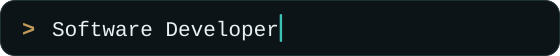

<b>Computer Engineering student and software developer</b> building modern applications, backend systems and premium user experiences, with a focus on the Apple ecosystem.

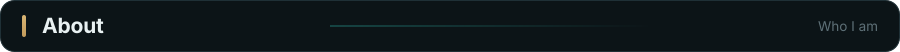


I'm Sadra, a Computer Engineering student who likes building complete products: thoughtful interfaces, solid APIs and the details in between. Right now I'm focused on **Moneta**, a native macOS personal finance app, and on growing my backend and product skills alongside it.

 


 


 


**Moneta** is a native macOS personal finance app that I'm designing and building end to end. Its visual identity is calm and warm: off-white surfaces, deep petrol, charcoal type and bronze details. It is under development and the repository is private.

Planned capabilities: `Dashboard` `Net worth` `Accounts` `Transactions` `Categories` `Budgets` `Goals` `Recurring transactions` `Analytics` `Reports and export` `Financial health score` `Insights` `Backup and restore`

**More work**

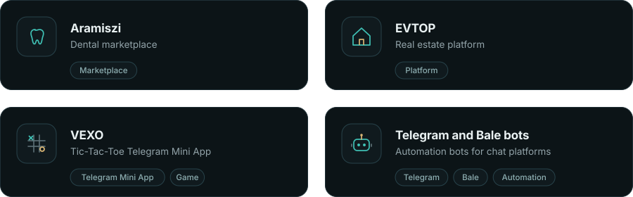

 


 


These cards are generated from the GitHub API by a scheduled GitHub Actions workflow in this repository. They only reflect public activity; private work stays private.

 


 

Follow along on GitHub, or get in touch through the links below.

<a href="https://github.com/Sadrast?tab=repositories">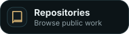</a>

 

Every visual here is hand-built SVG. No third-party widgets.

